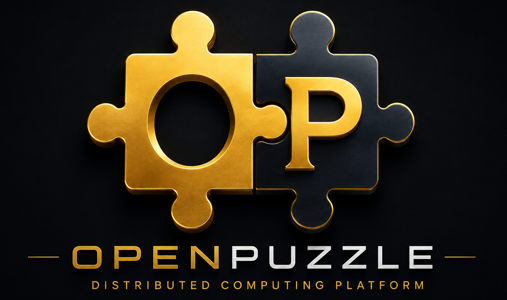

# OpenPuzzle

OpenPuzzle coordinates distributed searches for the public Bitcoin Puzzle. The desktop and command-line clients request a range, run it with a compatible search engine and report progress to the coordinator.

[Downloads](https://github.com/claudiodb007/OpenPuzzle/releases/latest) · [Project dashboard](https://claudiodb.com/) · [Português](#guia-rápido-em-português)

## Install on Linux

On **Ubuntu 26.04 x86-64**, download the [Linux DEB](https://github.com/claudiodb007/OpenPuzzle/releases/download/v1.0.63/OpenPuzzle-1.0.63-Linux-x86_64.deb). From your downloads directory, run:

```bash
sudo apt install ./OpenPuzzle-1.0.63-Linux-x86_64.deb
```

Open **OpenPuzzle** from the applications menu or run `openpuzzle-ui`. Install the driver for your GPU before using a CUDA or OpenCL engine.

## Install on Windows

Run the [Windows x64 installer](https://github.com/claudiodb007/OpenPuzzle/releases/download/v1.0.63/OpenPuzzle-1.0.63-Windows-x86_64-Setup.exe), then open **OpenPuzzle 1.0.63** from the Start menu. For the [portable ZIP](https://github.com/claudiodb007/OpenPuzzle/releases/download/v1.0.63/OpenPuzzle-1.0.63-Windows-x86_64.zip), extract everything and open `Start.cmd`.

## Start a search

1. Pick a mode and a device. On Windows, use **BitCrack / CUDA** for NVIDIA, **BitCrack / OpenCL** for a compatible GPU, or **KeyHunt / CPU**.
2. Run **Benchmark** to create a measured profile if prompted. Use puzzle **0** to choose the first unsolved puzzle, or enter a puzzle number.
3. Click **Start**. The status card shows the active range, speed and telemetry available from the driver. Open **GPU power and fans** to view supported controls.

Use **Safe Stop** to finish the current range before the app takes another. Wait for it to finish before upgrading. For the public Puzzle 71, **Vanity / CUDA** is available on Linux and Windows with a supported NVIDIA GPU. Select Puzzle 71 and create a CUDA benchmark profile if prompted. After **Stop now**, choose **Recover** to resume the same range while its lease is valid. On Windows, if the coordinator confirms the assignment expired or is missing, OpenPuzzle archives the checkpoint and requests a new range.

```bash
openpuzzle run          # First unsolved puzzle
openpuzzle run 71       # Choose a puzzle explicitly
openpuzzle status       # Show local execution status
openpuzzle safestop     # Finish active work and stop taking new ranges
```

## Guia rápido em português

1. Em **Ubuntu 26.04 x86-64**, descarrega `OpenPuzzle-1.0.63-Linux-x86_64.deb` e instala com `sudo apt install ./OpenPuzzle-1.0.63-Linux-x86_64.deb`. Abre **OpenPuzzle** pelo menu de aplicações.
2. Em **Windows x64**, usa o instalador e abre **OpenPuzzle 1.0.63** no menu Iniciar. Se preferires a versão portátil, extrai o ZIP completo e abre `Start.cmd`.
3. Escolhe o modo e o dispositivo. Em Windows, usa **BitCrack / CUDA** para NVIDIA ou **BitCrack / OpenCL** para uma GPU compatível. Corre **Benchmark** se for pedido, usa o puzzle **0** para selecionar o primeiro por resolver e carrega em **Iniciar**.
4. Para usar o **Vanity / CUDA** no Windows, escolhe uma GPU NVIDIA e o **Puzzle 71**. Se parares com **Parar agora**, usa **Recuperar**. Se o servidor confirmar que a atribuição expirou ou já não existe, o OpenPuzzle arquiva o checkpoint e pede um novo range. Usa **Safe Stop** para terminar o range atual antes de parar. Em **Potência e ventoinhas das GPUs**, podes ver os controlos que o driver disponibiliza.

Para pedir ajuda, abre **Mensagens** e usa **Copiar diagnóstico**. Em inglês, o botão aparece como **Copy diagnostics**.

## Documentation

- [Windows quick start in Portuguese](https://github.com/claudiodb007/OpenPuzzle/blob/v1.0.63/OpenPuzzle/docs/WINDOWS_QUICK_START_PT.md)
- [Continuous execution and recovery](https://github.com/claudiodb007/OpenPuzzle/blob/v1.0.63/OpenPuzzle/docs/CLIENT_RUNTIME.md)
- [Report a problem or suggest an improvement](https://github.com/claudiodb007/OpenPuzzle/issues)
- [MIT license](https://github.com/claudiodb007/OpenPuzzle/blob/main/LICENSE)

## Support OpenPuzzle

If OpenPuzzle has been useful to you and you would like to support its development, you can make a Bitcoin donation.

Bitcoin:

`bc1qs946xs860jpqd5jv8fcv3jzkpwwydmz44w25h6`

Thank you for supporting OpenPuzzle.
